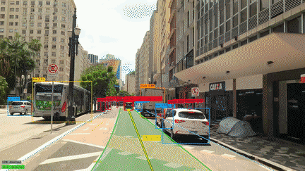
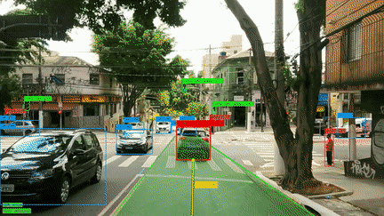
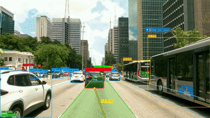
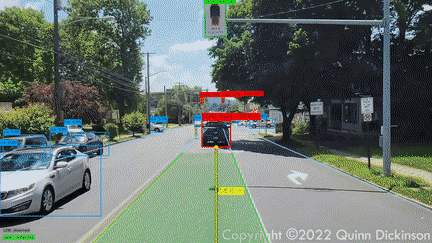
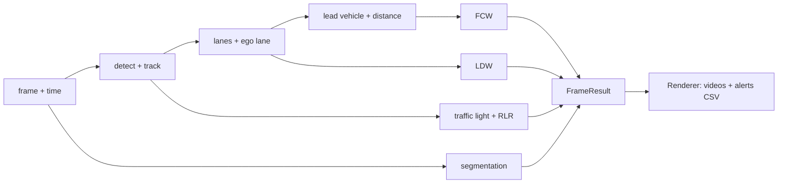
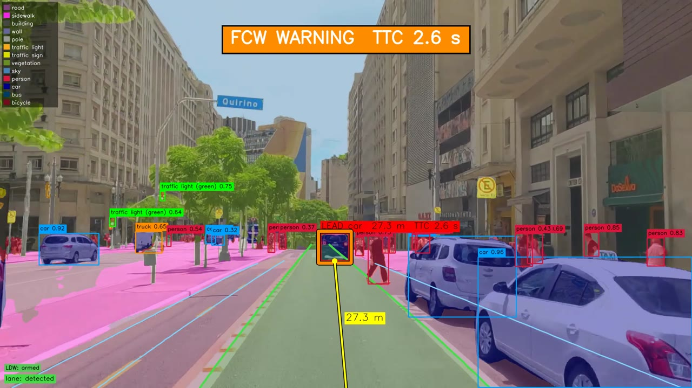

# adas-visual-perception

ADAS perception for dashcam video in C++ and TensorRT: detection and tracking, lane detection, lead-vehicle
distance, forward collision warning (FCW), lane departure warning (LDW) and red-light running (RLR). A semantic
segmentation layer is drawn on top. The library is `adasvp`; `video_demo` is the command-line program that
annotates a video and writes the alert events to a CSV.

<table>
  <tr>
    <td align="center" width="50%">
       
      FCW: sp1_crop_30fps, 30.63 s
    </td>
    <td align="center" width="50%">
       
      FCW: sp1_crop_2_30fps, 18.39 s
    </td>
  </tr>
  <tr>
    <td align="center" width="50%">
       
      LDW (left): sp1_crop_4_30fps, 148.08 s
    </td>
    <td align="center" width="50%">
       
      RLR: red_crop_11_30fps, 15.53 s
    </td>
  </tr>
</table>

Each GIF is 10 s of the C++ output (accurate profile, detections view), centred on the moment the alert fires. The
green area is the ego lane. The lead vehicle (the one FCW watches) has a red `LEAD` box and a yellow line to the
camera with its distance; when FCW fires, the box gets an orange outline.

- **FCW on `sp1_crop_30fps`, 30.63 s:** a downtown street. The car closes in on the lead vehicle 27 m ahead in its
  lane, the time to collision (TTC) falls to 2.6 s, under the 2.7 s threshold, and the `FCW WARNING` banner appears
  with the TTC.
- **FCW on `sp1_crop_2_30fps`, 18.39 s:** crossing an intersection behind a white car. The car is 10.7 m ahead
  when the TTC falls to 2.2 s and the warning fires.
- **LDW (left) on `sp1_crop_4_30fps`, 148.08 s:** a wide avenue. The car drifts towards the left line of its lane:
  it is 0.27 m from the line and moving sideways at 0.78 m/s, so it would cross the line in 0.34 s. `LDW << LEFT`
  appears and the left line turns orange.
- **RLR on `red_crop_11_30fps`, 15.53 s:** a suburban road. The traffic lights over the car's lane are red as it
  approaches (seen red for 3.8 s) and are still red when they leave through the top of the frame, so the car went
  through on red and the `RED LIGHT RUNNING` banner fires.

The `red_crop_*` clips carry a watermark of the channel they come from; see [License](#license).

## What it does

`Pipeline::process(frame, t)` runs, in this order:

1. Detection and tracking of people, vehicles and traffic lights: `YoloDetector` (YOLO26) and `ByteTracker`
   (`src/models/yolo_detector.cpp`, `src/track/byte_tracker.cpp`).
2. Lane detection and the ego lane: `LaneDetector` (Polar R-CNN) and `EgoLaneTracker`
   (`src/models/lane_detector.cpp`, `src/adas/ego_lane.cpp`).
3. Lead vehicle and its distance, from the width and the ground contact of its box: `LeadVehicleEstimator`
   (`src/adas/lead_vehicle.cpp`).
4. FCW, from the time to collision of the lead's box scale: `FCWMonitor` (`src/adas/fcw.cpp`).
5. LDW, only when both lane boundaries have been reliably observed: `LDWMonitor` (`src/adas/ldw.cpp`).
6. Traffic-light colour and RLR: `TrafficLightTracker` and `RLRMonitor` (`src/adas/traffic_light.cpp`,
   `src/adas/rlr.cpp`).
7. Segmentation (SegFormer, Cityscapes), a display layer that no alert depends on: `Segmenter`
   (`src/models/segmenter.cpp`).

Drawing is separate: `Renderer` (`src/render/renderer.cpp`) turns a `FrameResult` into the Detections,
Segmentation and Combined views. [docs/algorithm.md](docs/algorithm.md) describes every stage with its
thresholds.

  
   
  The Combined view.

## Measured behaviour

When the port was made, `video_demo` was compared with the Python prototype ([Origin](#origin)) on the 17 test videos (alert events
matched by type and level or side, within 0.5 s, the tolerance never loosened). The port preserved the behaviour
the author had validated on the prototype's output videos:

- accurate profile: 17 of 17 videos identical to the Python prototype;
- fast profile: 16 of 17 identical, plus 1 borderline case: an FCW warning on `sp1_crop_30fps` at 127.96 s that
  the C++ did not fire. The minimum time to collision around it is 2.664 s in Python and 2.659 s in C++, against
  the 2.7 s threshold. Different inference engines (PyTorch and TensorRT) cannot be made equal at a threshold
  crossing.

The seven videos of the release, in events (FCW + LDW + RLR):

| Video | Accurate: Python / C++ | Accurate result | Fast: Python / C++ | Fast result |
|---|---|---|---|---|
| `sp1_crop_30fps` | 5 / 5 | identical | 4 / 3 | 3 identical, 1 borderline |
| `sp1_crop_2_30fps` | 1 / 1 | identical | 1 / 1 | identical |
| `sp1_crop_3_30fps` | 0 / 0 | identical | 0 / 0 | identical |
| `sp1_crop_4_30fps` | 7 / 7 | identical | 7 / 7 | identical |
| `red_crop_11_30fps` | 1 / 1 | identical | 1 / 1 | identical |
| `red_crop_12_30fps` | 1 / 1 | identical | 1 / 1 | identical |
| `red_crop_13_30fps` | 1 / 1 | identical | 1 / 1 | identical |

Speed recorded when the port was made, in frames per second averaged over the 17 videos weighted by frames, with `--dry --no-seg` (decode, lanes,
detection, tracking and ADAS, no encoding), on an RTX 4070 Laptop GPU:

| Profile | C++ | Python prototype |
|---|---|---|
| fast | 129.2 | 20.1 |
| accurate (fp16 detector, the default) | 48.6 | 12.7 |
| accurate (fp32 detector, `--det-precision fp32`) | 20.3 | not measured |

The Python numbers include model loading and are noisy (shared GPU). Going forward, the regression baseline is
the C++ output itself (`tests/regression/golden/`): `tools/regression/run_cpp_regression.sh` compares a run with it
and expects every pair identical. The tables, the procedure and the tools are in
[docs/regression.md](docs/regression.md) and [tools/regression/README.md](tools/regression/README.md).

## Requirements

An NVIDIA GPU with a driver, CUDA, TensorRT 10, OpenCV 4 and ffmpeg, either from the Docker image or from a
native install. See [docs/install.md](docs/install.md).

## Build

Dependencies: CUDA toolkit 12.x or newer with `nvcc`, TensorRT 10, OpenCV 4 and CMake 3.24 or newer. The tests
fetch Catch2 (and nlohmann_json when it is not installed) with CMake FetchContent, and configuring the examples
fetches CLI11 unless it is installed, so the first configure may need network access
(`-DADASVP_BUILD_EXAMPLES=OFF` avoids CLI11, `-DADASVP_BUILD_TESTS=OFF` skips the tests).

    cmake --preset native-release
    cmake --build build/native-release -j
    ctest --test-dir build/native-release --output-on-failure

The preset uses `/usr/local/cuda/bin/nvcc`. For another CUDA toolkit override it on the command line:

    cmake --preset native-release -DCMAKE_CUDA_COMPILER=/path/to/nvcc

or keep it in an untracked `CMakeUserPresets.json` that inherits the preset:

    {
      "version": 3,
      "configurePresets": [{
        "name": "mine", "inherits": "native-release",
        "cacheVariables": { "CMAKE_CUDA_COMPILER": "/path/to/nvcc" }
      }]
    }

`video_demo` ends up in `build/native-release/examples/`. TensorRT engines are built on first use and cached in
`${XDG_CACHE_HOME:-$HOME/.cache}/adasvp/engines`.

The test suite has 75 tests (75/75 in the last full run, none skipped). Without models they cover Config and the command line,
the 60 traffic-light fixtures, and the synthetic RLR, FCW, lead-vehicle, ego-lane and LDW-label tests. With
`models/` populated and `ADASVP_VIDEOS_DIR` pointing at the test videos they add the pipeline and regression
tests. The trace-replay and renderer-comparison tests also need gitignored traces and are skipped when those are
missing (how to make them: [tools/regression/README.md](tools/regression/README.md)). The Python tool tests run
with `.venv/bin/python -m pytest tests -q`.

A Docker image with the toolchain is described in [docs/install.md](docs/install.md); `scripts/video_demo_docker.sh`
runs `video_demo` in it.

## Get the models

    scripts/download_models.sh [--profile fast|accurate|all] [--dest DIR]

The script downloads from the GitHub release into `models/` of the repository (whatever the current directory), checks each sha256 and only then gives the file its
final name, so an interrupted download is simply repeated. It needs `curl` and `sha256sum`.

| Profile | Files | Download |
|---|---|---|
| `fast` | `yolo26s.onnx`, `segformer-b1-cityscapes-1024x576.onnx`, `polarrcnn_curvelanes_dla34.onnx` | about 158 MB |
| `accurate` | `yolo26x.onnx`, `segformer-b5-cityscapes-1280x720.onnx`, `polarrcnn_curvelanes_dla34.onnx` | about 628 MB |
| `all` (default) | the five models | about 722 MB |

To export the models yourself instead, see [docs/install.md](docs/install.md) and
[tools/export/README.md](tools/export/README.md). Licenses and credits: [models/README.md](models/README.md).

## Get the test videos

    scripts/download_videos.sh [--dest DIR]

Seven clips (about 1 GB in total) go to `videos/` of the repository (whatever the current directory), with the `red_crop_*` ones in
`videos/redlights/`. The `red_crop_*` clips come from [Quinn Dickinson's YouTube channel](https://www.youtube.com/@QuinnDickinson2610).
`video_demo` takes any video file, so you can also use your own clips.

## Run

See everything at once in a live window (segmentation, detections, lanes, lead vehicle and alerts):

    build/native-release/examples/video_demo videos/sp1_crop_30fps.mp4 --show comb

`--show` only displays (nothing is written). Keys: `q` / ESC quit, SPACE pause. The very first run builds the
TensorRT engines before the window opens, which takes several minutes (see below). Other ways to run it:

    # write the videos and the alerts CSV instead of showing them
    build/native-release/examples/video_demo videos/sp1_crop_30fps.mp4
    # faster profile (SegFormer-B1 + YOLO26s), custom output prefix
    build/native-release/examples/video_demo videos/sp1_crop_30fps.mp4 -o outputs/sp1_fast --profile fast
    # a 20 s segment, without segmentation
    build/native-release/examples/video_demo videos/sp1_crop_4_30fps.mp4 --start 140 --duration 20 --no-seg
    # red-light running clip with a wider RLR zone
    build/native-release/examples/video_demo videos/redlights/red_crop_11_30fps.mp4 --rlr-zone 0.2 0.8
    # live window with only the detections view (det, the default of --show) or only the segmentation (seg)
    build/native-release/examples/video_demo videos/sp1_crop_30fps.mp4 --profile fast --show
    build/native-release/examples/video_demo videos/sp1_crop_30fps.mp4 --show seg

Without `-o` the outputs go to `outputs/<video name>_*`: `_detections.mp4`, `_segmentation.mp4`,
`_combined.mp4` and `_alerts.csv` (type, time, frame, level or side, time to collision, distance). Run it from the
repository root, or pass `--models-dir`. If a model is missing, it stops with
`[error] model not found: <path>` and tells you to run `scripts/download_models.sh` or pass `--models-dir`.

The first run with a model is slow: `video_demo` prints
`[adasvp] building TensorRT engine for <model> (first run only, may take several minutes)` and builds the
TensorRT engine, which takes minutes (about 10 minutes for the fp16 YOLO26x engine). The engine is cached, so
later runs start quickly.

`-h` prints the full help, with the same options and more examples. Every option:

| Option | Default | What it does |
|---|---|---|
| `-o PREFIX`, `--out-prefix PREFIX` | `outputs/<video name>` | Prefix of the output files: `PREFIX_detections.mp4`, `PREFIX_segmentation.mp4`, `PREFIX_combined.mp4`, `PREFIX_alerts.csv`. The folder is created if missing. |
| `--start SEC` | `0` | Start processing at this time, in seconds. |
| `--duration SEC` | until the end | Process only this many seconds. |
| `--no-combined` | off | Do not write the combined video. |
| `--encoder {auto,nvenc,x264}` | `auto` | Output encoder: NVENC on the GPU, x264 on the CPU, or NVENC when available. |
| `--no-audio` | off | Do not copy the source audio to the outputs. |
| `--models-dir DIR` | `models` | Directory with the ONNX models (see Get the models). A relative `--seg-model` / `--det-model` name is looked up here. |
| `--profile {accurate,fast}` | `accurate` | Model set: SegFormer-B5 + YOLO26x, or SegFormer-B1 + YOLO26s. |
| `--no-seg` | off | Turn segmentation off (detection only). |
| `--no-det` | off | Turn detection off (segmentation only). Lanes, FCW, LDW and RLR are off too. |
| `--no-lane` | off | Turn lane detection off. The lead vehicle is chosen by the fixed trapezoid corridor and LDW is off. |
| `--show [{det,seg,comb}]` | off (`det` if given without a value) | Open a live window instead of writing files; nothing is written, not even the CSV. Needs a display. Keys: `q` / ESC quit, SPACE pause. |
| `--show-width PX` | `1280` | Width of the `--show` window. |
| `--seg-model ONNX` | profile default | Segmentation ONNX file: a path, or a name looked up in `--models-dir`. |
| `--seg-size WxH` | ignored | Accepted for compatibility with the Python prototype, ignored: the resolution is fixed by the ONNX file. |
| `--seg-every N` | `1` | Run segmentation every N frames and repeat the last mask in between. |
| `--seg-alpha A` | `0.45` | Opacity of the segmentation colours, 0 to 1. |
| `--no-legend` | off | Do not draw the segmentation class legend. |
| `--det-model ONNX` | profile default | YOLO ONNX file: a path, or a name looked up in `--models-dir`. |
| `--det-imgsz PX` | `1280` (accurate), `960` (fast) | YOLO input size; larger sees small, distant objects but is slower. |
| `--conf C` | `0.30` | Minimum detection confidence, 0 to 1. |
| `--hfov DEG` | `75` | Horizontal field of view of the camera (sets the focal length for the distance estimate). |
| `--cam-height M` | `1.5` | Camera height above the ground, in metres. |
| `--horizon FRAC` | `0.59` | Height of the horizon in the image, as a fraction of the height (0 = top). |
| `--corridor-bottom FRAC` | `0.12` | Half-width of the trapezoid corridor at the image bottom, as a fraction of the width. Used for the lead vehicle when there is no ego lane, with `--no-lane` or with `--no-lane-corridor`. |
| `--corridor-top FRAC` | `0.02` | Half-width of the corridor at the horizon. |
| `--lanes-thr C` | `0.44` | Minimum confidence of a detected lane. |
| `--lanes-hold SEC` | `2.5` | How long the ego lane keeps being extrapolated (held, fading) after it stops being detected. |
| `--no-lane-corridor` | off | Draw the lanes but keep the trapezoid corridor to choose the lead vehicle. |
| `--no-fcw` | off | Turn the forward collision warning off. |
| `--no-ldw` | off | Turn the lane departure warning off. |
| `--no-rlr` | off | Turn the red-light running alert off. |
| `--fcw-ttc SEC` | `2.7` | FCW warning level: time to collision below this value. |
| `--fcw-ttc-critical SEC` | `1.5` | FCW critical level (flashing banner). |
| `--ldw-margin M` | `0.25` | LDW fires when the wheel is within this distance of the line (plus an allowance that grows with the approach speed) and the car is approaching it. Larger is more sensitive and risks false alarms. |
| `--ldw-car-width M` | `1.8` | Car width, in metres. |
| `--rlr-zone L R` | `0.25 0.75` | A red light only counts if it leaves the image through the top edge between these horizontal positions, as fractions of the width. |
| `--alert-display SEC` | `2.0` | Minimum time the banners and highlights stay on screen after an alert; visual only, the CSV is unchanged. 0 = only while active. |

## Project layout

| Path | What it is |
|---|---|
| `include/adasvp/` | Public headers: `Pipeline`, `Config`, `FrameResult`, `Renderer` |
| `src/` | The library: `models/` (YOLO, SegFormer, Polar R-CNN), `track/`, `adas/` (lanes, lead vehicle, FCW, LDW, RLR), `preprocess/`, `postprocess/`, `render/`, `trt/` |
| `examples/` | `video_demo`: command line, ffmpeg writer, alerts CSV |
| `tools/cpp/` | `adasvp_dump`, which writes per-frame dumps for the regression |
| `tools/export/` | Python tools that export the models to ONNX and validate them |
| `tools/regression/` | Dump, comparison and regression tools (C++ golden check, Python parity) |
| `prototype/python/` | The original Python prototype the C++ was ported from (history and optional parity check, not maintained) |
| `tests/` | C++ tests (Catch2), Python tool tests, fixtures, the C++ golden alert CSVs (`tests/regression/golden/`) and the Python prototype's alert CSVs (`tests/regression/python/`) |
| `scripts/` | Model and video download, Docker wrapper, release staging, GIF maker |
| `docs/` | [algorithm.md](docs/algorithm.md), [install.md](docs/install.md), [regression.md](docs/regression.md), media |
| `models/` | Where the ONNX models go (not versioned); [models/README.md](models/README.md) |

## Limitations

- Night driving is not supported. At night YOLO often sees only the lamp glow of a traffic light, not its
  housing, so lights are detected much less and night RLR is mostly missed.
- The camera is not calibrated. A horizontal field of view of 75 degrees, a camera height of 1.5 m and a horizon
  at 0.59 of the image height are assumed, so distances are approximate. Set `--hfov`, `--cam-height` and
  `--horizon` for your camera.
- A traffic light on a pole at the side of the road leaves the image through the side, outside `--rlr-zone`, and
  is not checked by RLR.
- There are no virtual lanes at intersections: without a detected lane the lead vehicle falls back to a fixed
  trapezoid corridor, and LDW stays silent.
- The frame rate is assumed constant: every time window is derived from the video's frame rate, and a variable
  frame interval is not supported.
- There is no vehicle speed (no CAN or GPS), so LDW cannot be suppressed at low speed or when the turn signal is
  on. It is conservative by design and prefers silence to a false alarm.
- A threshold crossing can differ between TensorRT and PyTorch (the Python prototype) by float noise (the borderline FCW
  above).
- `video_demo` deliberately differs from the Python prototype: `--seg-model` and `--det-model` take ONNX files
  (a path or a name in `--models-dir`), `--tracker` is removed, `--seg-size` is accepted but ignored, a missing
  ffmpeg or a `--start` beyond the end of the video is an error with exit code 1, and `--dry` still writes the
  alerts CSV.
- It needs an NVIDIA GPU with TensorRT. `Pipeline::process` is not thread-safe: use one `Pipeline` per thread.

## License

The code is licensed under the AGPL-3.0 ([LICENSE](LICENSE)). The models and data it uses have their own
licenses:

| Model / dataset | License |
|---|---|
| YOLO26 (Ultralytics) | AGPL-3.0 |
| SegFormer B1/B5 Cityscapes (NVIDIA) | NVIDIA Source Code License, non-commercial use only |
| Polar R-CNN DLA34 CurveLanes | No license declared by the authors; redistributed for non-commercial academic use with credit |
| CurveLanes (training data) | Non-commercial |
| Cityscapes (training data) | Non-commercial |

Origins and credits: [models/README.md](models/README.md). The `red_crop_*` test videos come from
[Quinn Dickinson's YouTube channel](https://www.youtube.com/@QuinnDickinson2610) (the clips carry its
"Copyright ©2022 Quinn Dickinson" watermark).

## Origin

The project started as a Python prototype (now in [prototype/python/](prototype/python/)), which the
author tuned by watching the annotated output videos. It was then ported line by line to C++ and TensorRT, and the
port was checked against the prototype event by event (see [Measured behaviour](#measured-behaviour)). The C++ is
the maintained implementation and the source of truth: `tests/regression/golden/` holds its alert baseline. The
Python prototype is kept for history and for an optional parity check, and is not maintained.
