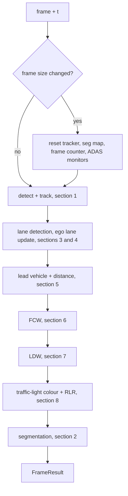

# How adas-visual-perception works

`adasvp::Pipeline::process(frame, t)` takes one BGR frame and its timestamp and returns a `FrameResult`: tracked
objects, lanes, a segmentation map, the lead vehicle with its distance, the ego lane, and the FCW / LDW / RLR
alerts. This page describes each stage, with the thresholds exactly as they are in the code. Every number below is
either a default of `adasvp::Config` (`include/adasvp/adasvp.hpp`, `src/config.cpp`) or a constant in the file named
in the section.

The C++ is a line-by-line port of the Python reference in `reference/python/dashcam_vision.py`. The stages that
follow keep the Python names (`EgoLaneTracker`, `LeadVehicleEstimator`, `FCWMonitor`, `LDWMonitor`, `RLRMonitor`)
so the two can be read side by side; [regression.md](regression.md) describes how the equivalence is checked.

## The order of one frame

The sections below are grouped by topic. The order in which `Pipeline::process` (`src/pipeline.cpp`) runs them is
different, and it matters because later stages read the results of earlier ones:



1. Detection and tracking (needs `enable_det`). Tracked boxes are clipped to the frame.
2. Lane detection, then `EgoLaneTracker::update` (needs `enable_lanes`).
3. Lead vehicle (`LeadVehicleEstimator`), using the ego lane as corridor when `lane_corridor` is on and the lane is
   available.
4. FCW. The lead is dropped for FCW when it is outside the ego lane (no margin).
5. LDW (needs lanes and `enable_ldw`).
6. Traffic-light colour and RLR (needs detection and `enable_rlr`).
7. Segmentation, last, every `seg_every` frames; between runs the previous map is reused. No ADAS stage reads it.

Couplings that follow from this order:

- FCW and RLR need the detector; LDW and the lane corridor need the lanes. A module whose input is off is not
  created, and its fields in `FrameResult` keep their idle values (`src/pipeline.cpp`, `AdasState`).
- Every time window is a frame count derived from `Config::frame_rate` (seconds * fps), so a constant frame rate
  is assumed. The tracker, segmentation map, frame counter and monitors are reset when the frame size changes.
- `process()` is not thread-safe: use one `Pipeline` per thread.

Drawing is not part of `process()`. `adasvp::Renderer` draws a `FrameResult` afterwards (section 9).

## 1. Detection and tracking

Files: `src/models/yolo_detector.cpp`, `src/preprocess/letterbox.cpp`, `src/track/byte_tracker.cpp`,
`src/track/kalman_xyah.cpp`, `src/track/assignment.cpp`.

Detector. A YOLO26 ONNX model run through TensorRT. The frame is letterboxed the Ultralytics way: scaled by
`min(imgsz/h, imgsz/w)`, padded with grey 114 to a multiple of 32, converted to planar float RGB in `[0, 1]` on the
GPU. The model emits at most 300 rows of `x1 y1 x2 y2 score class`; the C++ applies no NMS of its own. Rows are kept
when `score > conf` and the class is one of the COCO classes the pipeline uses, then mapped back to frame pixels and
clamped to the frame.

| Setting | Value | Where |
|---|---|---|
| `conf` | 0.30 | `Config` |
| classes kept | 0 person, 1 bicycle, 2 car, 3 motorcycle, 5 bus, 7 truck, 9 traffic light | `Pipeline::Impl::classes` |
| `det_imgsz` | 960 (fast), 1280 (accurate) | `Config::fast()`, `Config::accurate()` |
| model | `yolo26s.onnx` (fast), `yolo26x.onnx` (accurate) | same |
| detector precision | fp16 in both profiles | same |

Tracker. `ByteTracker` is a port of the Ultralytics 8.4.208 BYTETracker (Kalman filter on x, y, aspect ratio,
height; IoU association with a linear assignment solver). Parameters (`TrackerParams`):

| Parameter | Value |
|---|---|
| `high` (first association) | 0.25 |
| `low` (second association, IoU only, cost threshold 0.5) | 0.1 |
| `new_track` (minimum score to start a track) | 0.25 |
| `buffer` (frames a lost track is kept) | 30 |
| `match` (first-association cost threshold) | 0.8 |
| `fuse_score` | true |
| unconfirmed-track association threshold | 0.7 |
| duplicate removal (IoU distance) | 0.15 |

`fuse_score` multiplies the IoU similarity by the detection score before matching. Because `conf` (0.30) is above
`high` (0.25), every detection that reaches the tracker is a high-score detection with the default settings, so the
low-score second association only matters if `conf` is lowered. As in Ultralytics 8.4.208, `buffer` is a frame
count, whatever the video fps; the `frame_rate` argument of `ByteTracker` is unused. Track ids start at 1 and
`Object::track_id` is -1 for an untracked object.

## 2. Semantic segmentation

Files: `src/models/segmenter.cpp`, `src/preprocess/kernels.cu`, `src/postprocess/seg_kernels.cu`.

SegFormer (Cityscapes, 19 classes) through TensorRT. The frame is resized on the GPU to the input size of the
engine (1024x576 for B1, 1280x720 for B5), normalised with the ImageNet mean `0.485 0.456 0.406` and standard
deviation `0.229 0.224 0.225`, and run. The logits are upsampled bilinearly (`align_corners=False`, like PyTorch) to
the frame size and reduced with an argmax on the GPU, which gives a `CV_8UC1` map of Cityscapes class ids.

| Setting | Value |
|---|---|
| model | `segformer-b1-cityscapes-1024x576.onnx` (fast), `segformer-b5-cityscapes-1280x720.onnx` (accurate) |
| precision | fp16 in both profiles |
| `seg_every` | 1 (every frame); with N > 1 the last map is reused for N - 1 frames |

`FrameResult::seg_classes` is a fresh copy on every call. The map is only used for the Segmentation and Combined
views; no ADAS stage reads it, so `--no-seg` changes no alert.

## 3. Lane detection

Files: `src/models/lane_detector.cpp`, `src/preprocess/letterbox.cpp` (`polar_to_device`).

Polar R-CNN (DLA-34, trained on CurveLanes), `polarrcnn_curvelanes_dla34.onnx`, always run in fp32. The top part of
the frame is cut (the crop starts at row `round(H * 640 / 1440)`), the rest is resized to 800x320 and fed as
planar RGB in `[0, 1]`. The network outputs, for each candidate lane, 72 offsets of an x/y polyline (normalised to the
800x320 crop), the start and end of the visible part, and a score. A lane is kept when its score is `>= lanes_thr`
(0.44). The polyline is cut to the visible part, mapped back to frame pixels, and lanes left with one point or fewer
are dropped. The result is `FrameResult::lanes`: polylines with their score, ordered by the network output order.

## 4. Ego lane

Files: `src/adas/ego_lane.hpp`, `src/adas/ego_lane.cpp` (`EgoLaneTracker`, `lane_x_at`).

The ego lane is the pair of boundaries closest to the vehicle's path, tracked over time. It is represented as the
x position of the left and right boundary at 40 rows (`n_rows`) from `max(horizon + 0.04, 0.63) * H` (0.63 H with the
default horizon) down to `H - 1`.

Sampling a lane at the rows (`lane_x_at`). A detected lane is used only if it has at least 5 points, spans at least
`0.15 H` vertically, reaches below `0.75 H` and starts above `0.85 H`. It is fitted as x(y) with a polynomial of
degree 2 when the span exceeds `0.25 H`, otherwise degree 1. Inside the observed y range the polynomial is used;
outside it the lane is continued along its tangent, with the slope clipped to +-2.

Geometry. With `scale = (H - 1 - y_horizon) / cam_height` (pixels per metre at the bottom row):

| Quantity | Value |
|---|---|
| minimum lane width at the bottom row | `2.7 * scale * 0.75` |
| maximum lane width at the bottom row | `4.0 * scale * 1.10` |
| default width profile (before any observation) | `3.4 * scale * t_row`, `t_row` = 0 at the horizon, 1 at the bottom |
| jump gate | `0.07 W` |
| re-acquisition window (`persist`) | `max(3, int(0.3 * fps))` frames |
| smoothing factor of the boundaries | 0.35 |
| smoothing of the width profile | 0.9 old + 0.1 new |
| plausibility of a lane | width inside the min/max range, centre within `0.18 W` of the image centre |

Choosing the pair (`pick`). Sampled lanes are split into left and right by their x at the bottom row (`< W/2`).
A left/right pair is valid when its bottom-row width is inside the min/max range and the width at every row, relative
to the bottom width, follows the perspective profile: between `0.4 * t_row - 0.02` and `1.8 * t_row + 0.04`. Among
valid pairs, the one closest to the currently tracked boundaries wins; with no track yet, the narrowest wins. If no
pair is valid, a single boundary is accepted when its bottom x is within `2 * gate` of the tracked one (or within
`0.85 * wmax` of the image centre when nothing is tracked).

Temporal filter. A new observation more than `gate` away (mean absolute difference over the lower half of the rows)
from the track is rejected and flagged as a glitch; if the same new position is seen `persist` times in a row, it is
accepted as a re-acquisition and blended in by the smoothing. When only one boundary is observed, the other is
inferred from the width profile.

States (`LaneState`):

| State | Meaning |
|---|---|
| `Detected` | both boundaries observed this frame |
| `Partial` | one boundary observed, the other inferred |
| `Estimated` | nothing accepted; the last lane is held for `lanes_hold` seconds (2.5), with `fade` decreasing linearly from 1 to 0 |
| `None` | no lane |

`EgoLaneTracker::contains(box, margin)` is the test used by the lead vehicle and FCW: the bottom centre of the box
must lie between the boundaries at the box's bottom row, widened by `margin * lane width` (default 0.10, never less
than `0.01 W`). It is false when the lane is `None` or the box bottom is within 5 px of the horizon.

## 5. Lead vehicle and distance

Files: `src/adas/lead_vehicle.hpp`, `src/adas/lead_vehicle.cpp` (`LeadVehicleEstimator`).

Camera model. There is no calibration; the pinhole focal length comes from the horizontal field of view:
`f = (W / 2) / tan(hfov / 2)`.

| `Config` field | Default |
|---|---|
| `hfov` | 75 degrees |
| `cam_height` | 1.5 m |
| `horizon` | 0.59 (fraction of the frame height) |
| `corridor_bottom` | 0.12 (fraction of the width) |
| `corridor_top` | 0.02 |
| `lane_corridor` | true |

Candidates are tracked objects (with a track id) of class car, motorcycle, bus or truck that are in the corridor.
The corridor is the ego lane (`contains`, margin 0.10) when it is available and `lane_corridor` is on; otherwise a
trapezoid whose half-width goes from `corridor_top * W` at the horizon to `corridor_bottom * W` at the bottom of the
frame, centred on the image (a box whose bottom is within 5 px of the horizon is never in it).

Selection. The candidate with the lowest bottom edge (largest `y2`) is the lead. Hysteresis keeps the current lead
unless another candidate's bottom edge is at least `0.03 H` lower. When no candidate exists, the previous lead is
forgotten after `int(0.3 * fps)` frames.

Distance. Two cues are fused:

- Width cue: `Z = f * W_real / w_px`, with the typical rear width per class: car 1.80 m, motorcycle 0.80 m, bus
  2.55 m, truck 2.40 m. `w_px` is at least 1.
- Ground cue: `Z = f * cam_height / (y2 - y_horizon)`, valid when `y2 - y_horizon > 8` px (flat-road assumption).

The result is `0.6 * Z_width + 0.4 * Z_ground`. When the box touches the left or right border (within 2 px) the
width cue is unreliable and only the ground cue is used; when there is no ground cue only the width cue is used. The
distance is then smoothed per track: median of the last 9 values, then an exponential average
(`0.8 * old + 0.2 * new`). The average of a track is dropped when the lead changes to another track.

## 6. FCW (forward collision warning)

Files: `src/adas/fcw.hpp`, `src/adas/fcw.cpp` (`FCWMonitor`), `src/adas/theil_sen.hpp`.

FCW estimates the time to collision (TTC) from how fast the lead's box grows, which needs no calibration: if the
box width grows at the rate `r = d ln(w) / dt`, the time to contact is `1 / r`.

| `Config` field | Default |
|---|---|
| `enable_fcw` | true |
| `fcw_ttc` (warning) | 2.7 s |
| `fcw_ttc_critical` | 1.5 s |

Per frame, with the lead (already restricted to the ego lane by the pipeline, see "The order of one frame"):

1. Reset. The history is cleared if there is no lead for more than `0.3 * fps` frames, and when the lead track id
   changes.
2. Reject unreliable boxes. The window restarts when the box touches the frame edge (within 2 px), is narrower than
   40 px or shorter than 10 px, or is off the path: its centre is more than one box width from the image centre.
3. Window. Samples of `(t, ln w, distance, ln h)` over the last `win = 0.8` s.
4. Evaluate only when the window holds at least `max(8, int(0.55 * 0.8 * fps))` samples (13 at 30 fps), the lead has
   been the same track for at least 0.5 s, its distance is under 40 m, and the samples span at least `0.6 * 0.8` s.
5. Robust slopes by Theil-Sen (median of pairwise slopes): `r` of `ln w`, `rh` of `ln h`, and the closing speed
   `vz = -d(distance)/dt`.
6. Accept only when `r > 0.03`, `vz >= 0.5` m/s, `distance / vz < 2.5 * fcw_ttc`, `0.5 r <= rh <= 2 r + 0.05` (the
   height must expand consistently, so a turning vehicle that only widens is rejected) and `distance * r <= 14`
   (an implied closing speed of at most about 50 km/h; above that the box noise dominates). Then `TTC = 1 / r`.
7. Smoothing. The reported TTC is the median of the last 5 accepted values; one frame without a valid TTC clears them.
8. Debounce. A TTC below `fcw_ttc` counts towards activation; it must hold for `max(1, int(0.3 * fps))` consecutive
   frames (9 at 30 fps). The level is `critical` below `fcw_ttc_critical`, else `warning`. The alert ends after
   `max(1, int(0.5 * fps))` consecutive frames (15 at 30 fps) without the condition.
9. Event. `FcwStatus::event` is set when the alert activates and when an active warning escalates to critical; it
   becomes an `FCW` row in the alerts.

## 7. LDW (lane departure warning)

Files: `src/adas/ldw.hpp`, `src/adas/ldw.cpp` (`LDWMonitor`).

LDW is built on "robustness first": it is armed only when the lane measurement passes a series of checks, and any
failure disarms it and cancels an active alert at once. The vehicle is assumed to be centred in the image.

| `Config` field or constant | Value |
|---|---|
| `enable_ldw` | true |
| `ldw_car_width` | 1.8 m |
| `ldw_margin` | 0.25 m |
| lane width used to convert pixels to metres | 3.5 m (`pipeline.cpp`) |
| arming history `arm_s` | 1.0 s |
| speed fit window `fit_s` | 0.5 s |
| reference row | the row of the ego-lane grid closest to `0.93 H` |

Disarm reasons, checked in this order (the key under which `AdasStats::ldw_frames` counts the frames):

| Reason | Trigger |
|---|---|
| `state` | ego lane not `Detected`, or a boundary not observed this frame |
| `glitch` | a jump-gate rejection, re-acquisition or implausible lane this frame |
| `obs_vs_trk` | mean distance between the raw observation and the tracked boundary over the lower half of the rows exceeds 40 px on either side |
| `width` | lane width at the reference row, normalised to the bottom row, outside the min/max range of the ego lane |
| `convergence` | the width does not decrease towards the horizon, or the row where it vanishes is farther than `0.07 H` from the horizon row |
| `width_profile` | the width is not linear in y: largest residual above `0.04` of the reference width |
| `curve` | a boundary is not straight: largest residual of a line fit above `0.0065 W` (about 12 px) |
| `vanishing_point` | the two boundaries meet more than `0.08 W` apart, or more than `0.2 W` from the image centre |
| `arming` | less than about 1 s of clean history, or the lane width varied: standard deviation / mean >= 0.05 |
| `lat_speed` | lateral speed above 1.5 m/s (the history is cleared) |

Measurement. `DL` is the position of the image centre between the left line (0) and the right line (3.5 m):
`DL = (W/2 - xl) / (xr - xl) * 3.5` at the reference row. The lateral speed is the Theil-Sen slope of `DL` over the
last 0.5 s, and needs at least 8 samples. For each side, the distance from the wheel to the line is
`d = DL - 0.9` (left) or `(3.5 - DL) - 0.9` (right); `v` is the approach speed towards that line; the time to line
crossing is `tlc = d / v`.

A side triggers when all of these hold: `d < 0.25 + 0.3 v`, `d > -0.5`, `v >= 0.15` m/s, `tlc < 1.0` s, the net
approach over the history window is at least 0.25 m, the side is not in cooldown (2.5 s after its last alert ended)
and LDW is not suppressed (2.0 s after a disarm that happens while an alert is active or shortly after one, which is
how a deliberate crossing is silenced). The condition must hold for `max(1, int(0.3 * fps))` consecutive frames and the
alert ends after `max(1, int(0.5 * fps))` frames without it. `LdwStatus` carries the active side, `d`, `v` and `tlc`.

## 8. Traffic-light colour and RLR

Files: `src/adas/traffic_light.hpp`, `src/adas/traffic_light.cpp`, `src/adas/rlr.hpp`, `src/adas/rlr.cpp`.

Colour of a traffic light (`traffic_light_state`). Applied to each class-9 box (except boxes cut by the top edge:
`y1 <= 0.01 H`). The crop must be at least 4 px on each side. It is classed as vertical when `h >= 1.3 w`,
horizontal when `w >= 1.3 h`, and square boxes are `Unknown`. A margin of 15% of the short side is trimmed on both
sides of the short axis. The long axis is split in 3 cells. In each cell, the mean of the brightest 25% of pixels is
computed for brightness (max of B, G, R) and for three colour cues: red `R - G`, yellow `min(R, G) - B`, green
`G - R`. The expected lit cell is the first for red, the middle for yellow, the last for green (for horizontal
housings red may also be the last cell and green the first). The score of a colour is its cue in the expected cell
minus the larger of the same cue in the other two cells, plus `0.25` times the brightness difference of the expected
cell to the mean of the others. The colour with the best score wins if the score is at least 14; otherwise the colour
is `Unknown`.

Traffic-light tracker (`TrafficLightTracker`). A dedicated tracker, not ByteTrack; its ids are in
`TrafficLight::track_id` and do not match `Object::track_id`. It predicts each box with a constant velocity model
(Theil-Sen over the last 6 entries of centre and log size) and matches greedily on IoU minus a small centre-distance
penalty. A pair is a candidate when the IoU is above 0.1 or the centres are closer than the larger box side, and the
height ratio is between 0.5 and 2.0. A track is closed after `max(1, round(0.25 * fps))` frames without a match
(`max_lost_s = 0.25`); the history is trimmed to 90 entries once it exceeds 120.

RLR (red-light running) means the vehicle passes a red light that belongs to its path. The light's box climbs and
grows in the image as the car approaches; the event is evaluated once per track, when the light leaves through the top
of the frame.

| Constructor value | Default |
|---|---|
| `rlr_zone` (central zone of the width) | 0.25 to 0.75 |
| `top_cut` | 0.01 H |
| `top_band` | 0.12 H |
| `min_track_s` | 1.0 s |
| `min_growth` | 0.15 |
| `red_min_s` | 1.5 s |
| `cooldown_s` | 4.0 s |

A track is evaluated when its box reaches `y1 <= top_cut * H` while still matched, or when it is closed with its last
`y1 < top_band * H`. Evaluation requires, using only the entries not cut by the top edge:

1. at least 5 entries, the last box centre inside the central zone, a track of at least `min_track_s` and a last box at
   least 10 px high;
2. over the last 1.0 s, the log-height growth slope `>= min_growth` and the vertical centre velocity (per H) `<= -0.03`;
3. ignoring the last 0.2 s, in the last 2.2 s at least `max(6, 0.5 n)` entries red and at most `0.15 n` green or
   yellow (n = entries in that window);
4. the latest known colour in the last 0.7 s is red;
5. the light has been red for at least `red_min_s`, counted back from the last frame to the last green or yellow
   entry.

Two events are at least `cooldown_s` apart. The RLR row of the alerts carries `red_for_s` and no lead vehicle.
`FrameResult::lights` lists the lights currently matched, with the colour.

## 9. Drawing

Files: `include/adasvp/render.hpp`, `src/render/renderer.cpp`, `src/render/draw_primitives.cpp`.

`Renderer` is stateful because the alert banners persist and blink across frames. Call `render(frame, result, views)`
once per frame, in order. Views: `Detections` (lanes, boxes, lead vehicle, banners on the raw frame), `Segmentation`
(Cityscapes overlay and class legend) and `Combined` (Detections over the overlay). The drawing never changes an
alert; it only displays them.

| Setting | Value |
|---|---|
| `alert_display_s` | 2.0 s an FCW / LDW banner stays after its last active frame |
| RLR banner | stays `max(alert_display_s, 1.5)` s |
| `seg_alpha` | 0.45 weight of the Cityscapes colours |
| legend | classes found on every 8th pixel of every 8th row |
| ego-lane fill | translucent green, alpha `0.28 * fade` |
| banner blink | colour toggles every 5 frames (critical FCW, RLR) |

Ego lane lines are solid when `Detected` (or `Partial` for the observed side) and dashed otherwise; the boundary
being approached during an LDW alert is drawn orange. The lead vehicle is a red box labelled with class, distance and,
under an FCW alert, TTC, with a yellow line to the bottom centre of the image. The segmentation blend reproduces the
half-precision arithmetic of the Python overlay through a lookup table, so the output matches the Python drawing
(the test `Renderer matches the Python drawing` requires at least 99.5% identical pixels).

## What comes out

`FrameResult` (`include/adasvp/adasvp.hpp`):

| Field | Content |
|---|---|
| `t` | the timestamp passed in |
| `objects` | tracked objects, clipped to the frame (`box`, `cls`, `score`, `track_id`) |
| `detections` | detector output before the tracker (confidence and class filtered) |
| `lanes` | all detected lanes (`points` in frame pixels, `score`) |
| `seg_classes` | `CV_8UC1` Cityscapes class map, a fresh copy per call; empty when segmentation is off |
| `timings` | `det_ms`, `seg_ms`, `lanes_ms`, `track_ms`, `total_ms` |
| `lead` | `LeadVehicle` (`track_id`, `cls`, `box`, `distance_m`), or empty |
| `ego_lane` | `EgoLane`: `state`, `available`, `fade`, `rows_y`, `xl`, `xr`, `obs_l`, `obs_r`, `glitch` |
| `lights` | traffic lights with their colour (only when RLR runs) |
| `fcw` | `FcwStatus`: `ttc`, `active`, `level` (`""`, `warning`, `critical`), `event` |
| `ldw` | `LdwStatus`: `enabled`, `armed`, `side`, `event`, `d`, `v`, `tlc` |
| `rlr` | `RlrStatus`: `event` (`id`, `cx`, `red_for`, `growth`, `box`) or empty |
| `alerts` | `Alert` rows that are new in this frame |
| `debug` | the values behind the Python `--adas-debug` trace (LDW disarm reason, `last_v`, last full-check metrics) |

`Pipeline::stats()` returns event counters and the frames per LDW disarm reason.

Alerts CSV. `video_demo` writes `<prefix>_alerts.csv`, one row per new alert, with the header

```
time_s,frame,type,level_side,ttc_s,line_dist_m,lat_vel_mps,tlc_s,lead_id,lead_dist_m,red_for_s
```

`type` is `FCW`, `LDW` or `RLR`; `level_side` is `warning` / `critical`, `left` / `right`, or `red`. `time_s` has
2 decimals; `ttc_s`, `line_dist_m`, `lat_vel_mps` and `tlc_s` have 2 decimals, `lead_dist_m` and `red_for_s` 1.
FCW rows carry `ttc_s`; LDW rows carry `line_dist_m`, `lat_vel_mps` and `tlc_s`; FCW and LDW rows also carry the lead
vehicle (`lead_id`, `lead_dist_m`) when there is one; RLR rows carry only `red_for_s`. Empty fields mean no value.
The library itself writes `frame = -1` in `Alert`; the caller fills it.

## Known trade-offs

- Monocular distance is an estimate. Without calibration, `hfov`, `cam_height` and `horizon` are defaults; the width
  cue assumes a typical rear width per class, the ground cue a flat road. Set them for your camera.
- FCW uses the scale expansion of the lead's box, so it needs a stable box. It restarts its window on cut, small or
  off-path boxes, and it only warns for a lead inside the ego lane (when the lane is available).
- LDW is conservative by design: any failed check disarms it, so on bends, near intersections or with lane
  ambiguity it stays silent rather than guess.
- RLR only fires for a light that is tracked for at least a second, red for at least 1.5 s, in the central part of
  the image, and that leaves through the top of the frame. A red light seen from a stop, or one far to the side, does
  not trigger it. The colour is a heuristic on pixel statistics (threshold 14), not a learned classifier.
- All windows assume a constant frame rate taken from `Config::frame_rate`. A variable frame interval is not
  supported.
- Thresholds are applied to results of different inference engines than the reference (TensorRT instead of PyTorch),
  and detections or lanes sitting exactly at a threshold can differ by float noise. In the regression this showed up
  once: a borderline FCW (see [regression.md](regression.md)).
- Segmentation is a display layer: no alert depends on it.
- It needs an NVIDIA GPU with TensorRT. The first run builds the TensorRT engines, which can take minutes for the
  large models; they are cached afterwards.
- `Pipeline::process` is not thread-safe, and a CUDA error leaves the `Pipeline` unusable.
